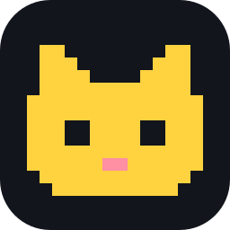
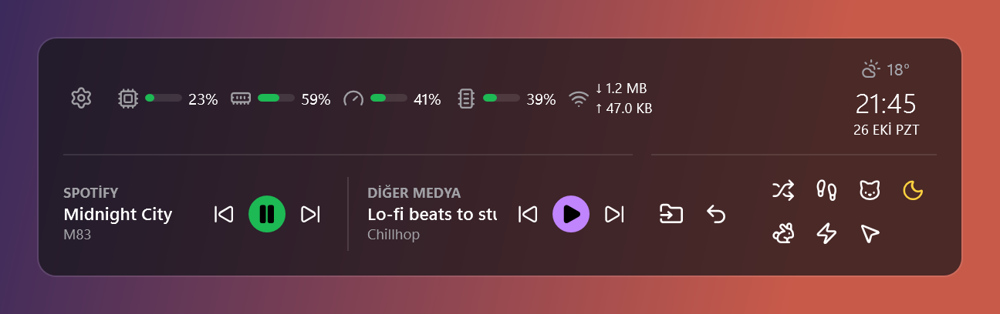
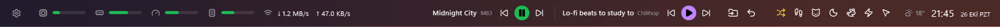
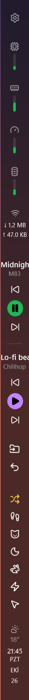
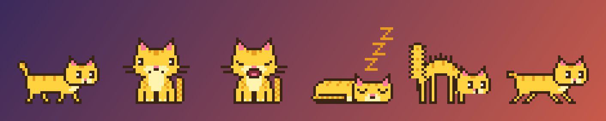
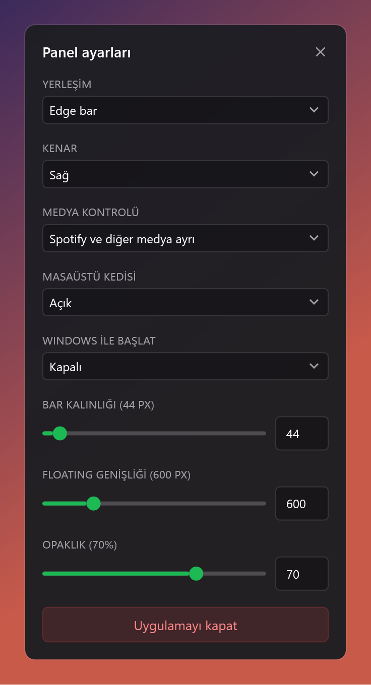

<div align="center">



# Sempulse

**Windows için hafif bir sistem ve medya çubuğu; masaüstünde yaşayan piksel bir kediyle birlikte.**

[](https://github.com/donsemleone/sempulse/releases/latest)
[](https://github.com/donsemleone/sempulse/releases)
[](https://github.com/donsemleone/sempulse/actions/workflows/ci.yml)
[](LICENSE)


**[⬇ Windows için indir](https://github.com/donsemleone/sempulse/releases/latest)** · [English](README.md) · Türkçe



</div>

Sempulse ekranın kenarında durur (ya da istediğin yerde süzülür) ve bilgisayarının ne yaptığını, ne çaldığını ve saati gösterir. Sarı, küçük bir kedi monitörlerinde dolaşır, duvarlara tırmanır, pencerelerinin üstünde uyur ve fare imlecini kovalar.

Tek bir yerel uygulamadır: tarayıcı motoru, arka plan servisi ya da hesap yoktur, hiçbir veri toplanmaz.

## Özellikler

### Sistem bir bakışta
CPU, bellek, GPU ve VRAM göstergeleri ile anlık indirme ve yükleme hızı. VRAM göstergesinin üzerine gelince kullanılan ve toplam GB görünür. GPU göstergesi en yoğun grafik motorunu, VRAM ise ayrık belleği olan kartı izler; iki ekran kartlı dizüstülerde çalışan kart gösterilir.

### İki medya oynatıcı tek yerde
Spotify'ın kendi kontrolleri vardır; geri kalan her şey (bir YouTube sekmesi, podcast uygulaması, video oynatıcı) ikinci kontrol grubunu kullanır. Tek kontrol istersen **Tek aktif medya** seçeneğine geçebilirsin. Uzun şarkı adları okunabilsin diye yavaşça kayar.

### Kenar çubuğu ya da floating panel
Sempulse'u ekranın üst, alt, sol ya da sağ kenarına ince bir çubuk olarak yerleştir. Windows onu görev çubuğu gibi tanır; ekranı kaplayan pencereler çubuğun kenarında durur. İstersen floating panele geçip istediğin yere sürükle.



<table><tr>
<td></td>
<td>

### Oyunlarda ve videolarda yoldan çekilir
Ana monitörde bir oyun ya da video tam ekrana geçince Sempulse ikinci monitörün sol altına floating panel olarak taşınır, kedi saklanır. Tek monitörde tam ekrandan çıkana kadar gizlenir. Ekran görüntüsü araçları yok sayılır; görüntü alırken hiçbir şey yer değiştirmez.

### Masaüstünü tek tıkla topla
**Taşı**, ana monitörün masaüstündeki dosya, klasör ve kısayolları ikinci monitördeki boş yerlere yerleştirir. **Geri al** onları eski yerlerine döndürür. Yalnızca simgelerin konumu değişir; dosyaların kendisi asla taşınmaz. Masaüstünde "Simgeleri otomatik düzenle" açıksa Sempulse önce neyi kapatman gerektiğini söyler.

### Hava durumu ve saat
Saatin üstünde anlık sıcaklık ve hava durumu görünür (şimdilik İstanbul). Üzerine gelince günün en düşük, en yüksek sıcaklığı ve tahmini görünür.

</td>
</tr></table>

### Masaüstü kedisi



Kedi monitörlerinin tabanında yaşar ve kendi kafasına göre takılır:

- yürür, ekran kenarından yukarı tırmanır, tavanda baş aşağı yürür ve karşı taraftan iner
- üst üste duranlar dahil monitörler arasında gezer
- pencerelerinin üst kenarına zıplayıp orada oturur
- oturur, göz kırpar, esner, kıvrılıp uyur, tüylerini kabartır
- gece 23.00 ile 06.00 arasında daha çok uyur, daha az yürür
- fare imlecini fark eder, peşinden koşar, yaklaşınca üstüne atlar
- fareyle tutulup herhangi bir pencerenin üstüne bırakılabilir

Paneldeki yedi düğme kedinin ruh halini seçer: kendi seçsin, yürüsün, otursun, uyusun, zıplasın, tüylerini kabartsın ya da imleçle oynasın. Tıklamalar kedinin kendi pikselleri dışında alttaki pencerelere geçer; kedi ayarlardan kapatılabilir.

### Ayarlar



Yerleşim ve kenar, medya düzeni, kedi açık/kapalı, Windows ile başlat, çubuk kalınlığı, floating genişliği ve arka plan opaklığı (tamamen saydama kadar). Değişiklikler anında uygulanır ve hatırlanır.

## Bilgisayarını yormaz

Sempulse tek bir işlemdir. Sıradan bir masaüstünde yaklaşık **100 MB RAM** ve boştayken toplam işlemcinin **%1'inden çok daha azını** kullanır (tek çekirdeğin yaklaşık %3'ü; çoğu kayan şarkı adları ve kedinin yürüyüşü).

## Kurulum

1. [Son sürümden](https://github.com/donsemleone/sempulse/releases/latest) `Sempulse-<sürüm>-win-x64.zip` dosyasını indir.
2. İstediğin bir klasöre, örneğin `C:\Apps\Sempulse`, çıkar ve `Sempulse.exe`'yi çalıştır. Kurulum gerekmez; .NET dosyanın içindedir.
3. İsteğe bağlı: ayarları (dişli simgesi) açıp **Windows ile başlat** seçeneğini aç.

İndirilen dosya kod imzalı olmadığı için **Windows SmartScreen** "bilinmeyen yayımcı" uyarısı gösterebilir. **Ek bilgi → Yine de çalıştır** seçeneğine tıkla. Zip dosyasını aynı sürümdeki `SHA256SUMS.txt` ile karşılaştırabilir ya da uygulamayı kaynak koddan kendin derleyebilirsin (aşağıda).

**Gereksinimler:** 64 bit Windows 10 (2004 veya sonrası) ya da Windows 11. Masaüstü simgesi düğmeleri ve tam ekranda taşınma için ikinci bir monitör gerekir.

Kaldırmak için **Windows ile başlat** seçeneğini kapat, uygulamayı ayarlardan kapat ve klasörü sil. Ayarlar `%LOCALAPPDATA%\Sempulse` klasöründe durur.

## Gizlilik ve güvenlik

- **Veri toplanmaz.** Telemetri, analiz, hesap ya da çökme raporu yoktur.
- **Tek ağ isteği:** hava durumu, [Open-Meteo](https://open-meteo.com) üzerinden, sabit İstanbul koordinatlarıyla ve API anahtarı olmadan. Sen ya da bilgisayarın hakkında hiçbir bilgi gönderilmez.
- **Hiçbir şey dinlemez.** Sempulse port açmaz, bağlantı kabul etmez.
- **Her şey yerelde kalır.** Şarkı adları, pencere konumları ve masaüstü simgesi konumları bilgisayarında okunur ve dışarı çıkmaz.
- **Sisteme dokunuşu küçüktür.** Yalnızca kendi ayar klasörüne ve, istersen, kullanıcı hesabının altındaki tek bir "Windows ile başlat" kaydına yazar. Yönetici izni hiç gerekmez.

Bir güvenlik açığı bulursan lütfen herkese açık bir issue yerine [gizli güvenlik bildirimi](https://github.com/donsemleone/sempulse/security/advisories/new) aç.

## SSS

**Tam ekranda panel yer değiştirmiyor.** Tam ekran algılama yalnızca birincil monitörü izler. Monitörü tamamen kaplayan bir pencere (ya da çerçevesiz bir oyun penceresi) sayılır; normal ekranı kaplamış bir pencere sayılmaz.

**Sempulse zorla kapatıldıktan sonra ekranın bir şeridi boş kaldı.** Çubuk o şeridi görev çubuğu gibi ayırır. Normal çıkışta şerit her zaman geri verilir; işlem zorla sonlandırıldıysa (örneğin Görev Yöneticisi'nden) Windows, Explorer fark ettiğinde ya da en geç oturumu kapatıp açtığında şeridi serbest bırakır.

**Hava durumu konumunu ya da dili değiştirebilir miyim?** Henüz değil. Arayüz Türkçe, hava durumu İstanbul için; ikisi de planlanan ayarlar arasında.

**Nasıl kapatırım?** Ayarlar → **Uygulamayı kapat** ya da `Sempulse.exe --quit` komutu.

## Kaynaktan derleme

Windows ve [.NET 10 SDK](https://dotnet.microsoft.com/download/dotnet/10.0) gerekir.

```powershell
git clone https://github.com/donsemleone/sempulse.git
cd sempulse
dotnet test
dotnet run --project src/Sempulse
```

Sürümlerdeki tek dosyalık uygulamanın aynısını üretmek için:

```powershell
dotnet publish src/Sempulse -c Release -r win-x64 -o out
```

Kodun nasıl düzenlendiği için [CONTRIBUTING.md](CONTRIBUTING.md) dosyasına bak.

## Lisans ve teşekkürler

Sempulse [MIT Lisansı](LICENSE) ile yayımlanır.

İkonlar [Lucide](https://lucide.dev) (ISC), hava durumu verisi [Open-Meteo](https://open-meteo.com) (CC BY 4.0) kaynaklıdır. Ayrıntılar için [THIRD-PARTY-NOTICES.md](THIRD-PARTY-NOTICES.md).
